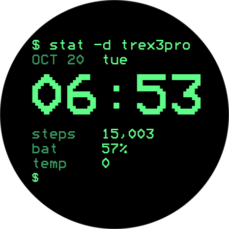

# stat -d

Terminal-style watch face for Amazfit T-Rex 3 Pro 48 mm (480 × 480) and 44 mm (466 × 466).

## How to deploy on your watches

1. Keep your watch connected to the Zepp app. Enable Developer Mode under **Profile → Settings → About** by tapping the Zepp icon seven times.
2. From the project folder, run `zeus login`, then `zeus preview`. Select the target matching your watch size (44 mm or 48 mm).
3. In Zepp, open your watch’s **Developer Mode → Scan** and scan the QR code to install.

See the [official preview guide](https://docs.zepp.com/docs/guides/quick-start/preview/) for details.

## Validation

Run `npm test`, `npm run lint`, `npm run format:check`, and `zeus build`.

Use `zeus dev -t 480x480-amazfit-t-rex-3-pro-48-mm` to send the face to the simulator.

Both screen sizes use the 480px design baseline.

## Code style

Run `npm run lint` and `npm run format:check` to check code style. Use
`npm run lint:fix` followed by `npm run format` to apply fixes.

### Symbol grid and debug overlay

Set `DEBUG = true` in `watchface/index.js` to display layout grid lines and character-cell boundaries. It defaults to `false`; no debug widgets are created when disabled. The overlay is static and adds no timers.

## Activity logging

`shared/debug.js` controls console diagnostics with `DEBUG_LOGS` (enabled for inspection). It is independent of the visual `DEBUG` grid. Log lines begin with `[stat -d]` and contain a sequence number, milliseconds since logger initialization, event name, and event details.

## Device targets

- 48 mm: `480x480-amazfit-t-rex-3-pro-48-mm` (device sources 10551552, 10551553, 10551555).
- 44 mm: `466x466-amazfit-t-rex-3-pro-44-mm` (device sources 10682624, 10682625, 10682627).

Build the smaller model with `zeus build -t 466x466-amazfit-t-rex-3-pro-44-mm`; run it with `zeus dev -t 466x466-amazfit-t-rex-3-pro-44-mm`.
Both targets deliberately use `designWidth: 480`. Assets in each target directory are stored at design resolution and scaled by Zeus; do not resize them to 466 manually. The temperature-font generator writes to both target directories.
